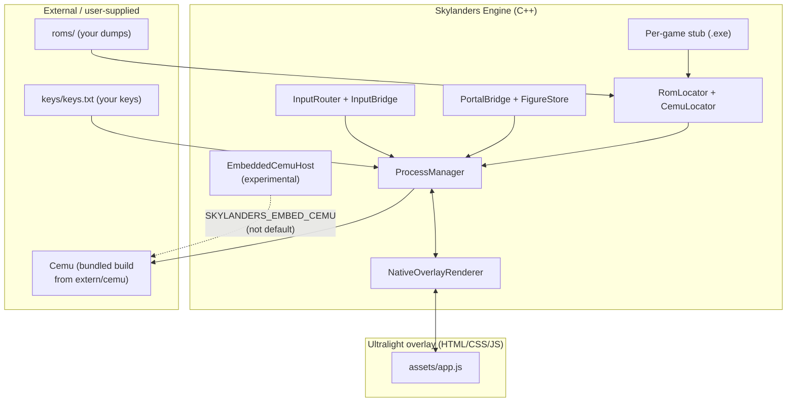

# Skylanders Engine

[](#first-time-setup)
[](#repository-layout)
[](LICENSE)

Skylanders Engine is a Windows launcher/runtime that makes the Wii U Skylanders games feel closer to native PC releases. It wraps a project-owned Cemu build, resolves user-supplied game files and keys, applies per-game emulator settings, and exposes an Ultralight overlay for portal figure placement, controls, diagnostics, and setup.

> **Fan project, no affiliation.** This is an unofficial community project.
> It is not affiliated with or endorsed by Activision, Toys for Bob,
> Microsoft, Nintendo, or the Cemu maintainers. Skylanders and all related
> characters, titles, and artwork are trademarks of their respective owners.

The project does not ship copyrighted game files, title keys, or generated figure saves. Those stay in ignored local folders.

## Current Status

The project is in a playable external-Cemu milestone:

- Six Wii U Skylanders stubs are supported: Spyro's Adventure, Giants, Swap Force, Trap Team, SuperChargers, and Imaginators.
- The preferred emulator backend is the bundled `extern/cemu` submodule built as an external `Cemu.exe`.
- True in-process embedded Cemu is experimental behind `SKYLANDERS_EMBED_CEMU` and is not the default.
- Ultralight starts hidden, boots Cemu automatically, and opens as an in-game overlay with `Start+Back` or `F1`.
- ROM discovery, key setup, portal figure creation/loading, controller mapping, and graphic-pack diagnostics are implemented.

See [docs/IMPLEMENTATION_STATUS.md](docs/IMPLEMENTATION_STATUS.md) for the detailed done/not-done list.

## Repository Layout

- `src/` and `include/skylanders/`: launcher/runtime C++ code.
- `assets/`: Ultralight HTML/CSS/JS and tracked UI assets.
- `extern/cemu/`: patched Cemu submodule used for the bundled backend.
- `tools/`: catalog, image import, and asset-gap scripts.
- `tests/`: lightweight C++ tests for catalog, locator, bridge, and config behavior.
- `docs/`: project map, handoff notes, generated manifests, and architecture docs.
- `roms/`: local user-supplied game files. Only `roms/README.md` is tracked.
- `keys/`: local user-supplied `keys.txt`. Only `keys/README.md` is tracked.
- `figures/`: generated `.sky` figure files and save state. Only `figures/README.md` is tracked.
- `runtime/`: local configs, downloads, diagnostics, MLC folders, logs, and controller profiles. Ignored.
- `sdks/ultralight/`: local Ultralight SDK. Ignored.

See [docs/PROJECT_MAP.md](docs/PROJECT_MAP.md) for feature ownership and data flows.

## Architecture



Each supported title gets a tiny stub executable; the stub name selects the
game, the launcher resolves the ROM and keys, prepares Cemu settings and
profiles, and supervises the emulator process. The overlay (toggled with
`Start+Back` or `F1`) talks to the launcher for portal placement, controls,
and diagnostics.

## First-Time Setup

1. Install Visual Studio with the C++ desktop workload and CMake support.
2. Initialize submodules if needed:

   ```powershell
   git submodule update --init --recursive
   ```

3. Put the Ultralight SDK at:

   ```text
   sdks/ultralight/
   ```

4. Put legally dumped Wii U game files in `roms/`, or choose them through the native file picker on first launch.
5. Put your own legally obtained Wii U keys in:

   ```text
   keys/keys.txt
   ```

6. Configure and build. The bundled build is the primary path:

   ```powershell
   cmake -S . -B build-bundled -DSKYLANDERS_BUILD_BUNDLED_CEMU=ON
   cmake --build build-bundled --config Release
   ```

   A non-bundled fallback build can be configured with:

   ```powershell
   cmake -S . -B build -DSKYLANDERS_BUILD_BUNDLED_CEMU=OFF
   cmake --build build --config Release
   ```

If MSBuild reports duplicate `Path`/`PATH` environment variables in this sandbox, run the build from a PowerShell session with the duplicate removed:

```powershell
Remove-Item Env:PATH -ErrorAction SilentlyContinue
cmake --build build-bundled --config Release
```

## Running

Launch one of the generated stubs from the Release output, for example:

```text
build-bundled/Release/Giants.exe
```

Normal boot should:

1. Resolve bundled Cemu.
2. Resolve the active game from the stub executable name.
3. Find a valid ROM in `roms/` or prompt for one.
4. Validate `keys/keys.txt`.
5. Prepare Cemu settings, game profile, controller profile, MLC path, and graphic-pack selections.
6. Launch Cemu.
7. Keep the Ultralight overlay hidden until toggled with `Start+Back` or `F1`.

## Verification

Recommended checks before handing off changes:

```powershell
node --check assets/app.js
cmake --build build --config Release
ctest --test-dir build -C Release --output-on-failure
cmake --build build-bundled --config Release
ctest --test-dir build-bundled -C Release --output-on-failure
```

## Packaging A Release

V1.6 adds a clean package flow for the bundled external-Cemu baseline:

```powershell
.\tools\package_release.ps1 -BuildDir build-bundled -Configuration Release
.\tools\smoke_check_release.ps1 -PackagePath out\releases\SkylandersEngine-<timestamp>
```

The package contains the stubs, bundled Cemu, Ultralight runtime files, tracked assets, docs, and empty `roms/`, `keys/`, and `figures/` folders. It intentionally excludes ROMs, keys, generated figures, and local `runtime/` state.

See [docs/V1_6_RELEASE_CHECKLIST.md](docs/V1_6_RELEASE_CHECKLIST.md) for the full release checklist and [docs/FIGURE_PERSISTENCE.md](docs/FIGURE_PERSISTENCE.md) for the figure save-state test.

## Native Overlay Roadmap

The V2 path is staged behind experimental backend modes. The current default remains bundled external Cemu with an external Ultralight overlay. The native path is documented in [docs/V2_NATIVE_OVERLAY_ROADMAP.md](docs/V2_NATIVE_OVERLAY_ROADMAP.md): V2.1 embedded bootstrap, V2.2 launcher-owned render host, V2.3 Ultralight composited into Vulkan, and V2.4 native backend as the default.

For V2.1 development, configure:

```powershell
cmake -S . -B build-embedded -DSKYLANDERS_EMBED_CEMU=ON -DSKYLANDERS_BUILD_BUNDLED_CEMU=ON
cmake --build build-embedded --config Release --target SkylandersEngineTests
ctest --test-dir build-embedded -C Release --output-on-failure
```

`EmbeddedNative` currently prepares Cemu headlessly and reports diagnostics; it does not own a render window or provide direct portal/input integration yet.

## Documentation Rules

Documentation is part of the implementation. If a change modifies runtime behavior, public bridge APIs, config file formats, Cemu patch behavior, asset layout, or setup requirements, update the relevant docs in the same commit.

Use [docs/DOCUMENTATION_MAINTENANCE.md](docs/DOCUMENTATION_MAINTENANCE.md) as the maintenance checklist.

## Third-party components

| Component | License | How included |
|---|---|---|
| [Cemu](https://github.com/cemu-project/Cemu) (Wii U emulator) | [MPL-2.0](https://www.mozilla.org/en-US/MPL/2.0/) | git submodule at `extern/cemu`, built from source — never shipped as a binary from this repo |
| [Ultralight](https://ultralight-ux.github.io/) (HTML/GPU UI toolkit) | Proprietary (free/paid tiers per vendor terms) | **local-only SDK drop** at `sdks/ultralight/` (git-ignored); you must obtain it yourself |
| Game logos under `assets/game-logos/` | Trademarks of their respective owners | small identification badges for the launcher UI in this non-commercial fan project |

`roms/`, `keys/keys.txt`, `figures/*.sky`, `runtime/`, and `sdks/` are
never part of this repository: only their placeholder READMEs are tracked.

## Contributing

Small fan project: open an issue describing your game build and setup
before changing emulator-facing behaviour, keep per-game quirks behind
catalog data rather than hard-coding them, and update the docs listed in
[DOCUMENTATION_MAINTENANCE.md](docs/DOCUMENTATION_MAINTENANCE.md) in the
same commit.

## License

My original launcher/runtime code in this repository is MIT-licensed —
see [LICENSE](LICENSE). Cemu (submodule) retains its MPL-2.0 license;
Ultralight is a separately obtained proprietary SDK and is not included.
